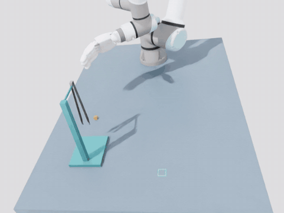

# UR5e + XHand 镊子操作：从相机标定到连续抓放

本项目将真实双相机标定与 Isaac Sim 仿真结合，使用 **UR5e + XHand** 完成从支架取镊、夹起物块、搬运和放置，并同步记录腕部与全局视角图像及操作轨迹。

## 当前 Demo

以下为 **2026-10-29 的完整仿真流程**，使用真实标定参数配置双相机。支架与镊子已沿世界 +Y 平移 10 cm，物块保持在原桌面位置。GIF 为 **2 倍速完整预览**；点击图片可打开原速全局视频。

[](demos/tweezer_pipeline/global.mp4)

**[原速全局视频](demos/tweezer_pipeline/global.mp4) · [原速腕部视频](demos/tweezer_pipeline/wrist.mp4) · [演示记录](demos/tweezer_pipeline/README.md)**

本次固定案例成功 **1/1**，总用时约 **45.08 秒**，最终物块 XY 误差约 **0.62 mm**。从取镊到夹物连续执行，交接时不重置机器人或物体。该结果不代表随机场景总体成功率或真机操作精度。

## 当前进展

| 内容 | 状态 |
|---|---|
| 真机相机标定 | D405 腕部相机、D435 全局相机标定及独立验证完成 |
| 仿真相机接入 | 已使用标定内外参，完成坐标关系与投影检查 |
| 取镊与夹放 | 几何阶段控制器 + 两个残差 PPO，固定案例完整通过 |
| 视觉与轨迹记录 | 已支持双视角视频、机器人/物体状态、动作和任务判定 |
| 随机场景评估、正式数据集 | 尚未完成 |
| VLA / WAM 训练、真机自主操作 | 尚未开展 |

当前机械臂从固定关节姿态出发，取镊后返回 HOME 附近完成姿态与握持检查，再夹取物块。跳过 HOME 直接夹物、示范轨迹引导等方案尚未实现。最新进度见 [PROJECT_PROGRESS.md](PROJECT_PROGRESS.md)。

## 快速运行

仿真环境为 **Isaac Sim 5.0.0 / Isaac Lab 2.2.1 / Python 3.11**，需要可用的 NVIDIA GPU 和相应驱动。脚本通过 `env/setup_sim.sh` 加载已有环境；新机器请按 [env/local.env.example](env/local.env.example) 配置 `env/local.env`。

以下命令从仓库根目录执行。本机开发路径为：

```bash
cd /cpfs/user/xiaoqihuang/tweezers-sim2real
```

### 完整流程：取镊 → 夹物 → 放置

```bash
bash scripts/test_tweezer_pipeline.sh \
  --out "runs/tweezer_pipeline_calibrated_$(date +%Y%m%d_%H%M%S)" \
  --pickup-checkpoint runs/rack_pickup_fixed_pilot_01/latest.pt \
  --place-checkpoint ../models/policies/xhand_pick_place_ppo.pt \
  --episodes 1 --video --device cuda:0
```

取镊检查点位于本机 `simulation/runs/`，**不随 Git 克隆提供**；需从已有训练结果恢复，或按下方入口训练。夹物策略位于 `models/policies/`。下载演示文件无需安装仿真环境或准备检查点。

默认支架与镊子根位置为 `(0.20, 0.62, 1.00)` m。`--rack-offset-y 0.10` 表示相对训练布局沿 +Y 平移 10 cm，`0` 可恢复原位置。只查看初始场景时，可用 `--preview-only` 替代 `--video`；预览不执行任务、不判定成功。详细配置见 [完整流程说明](docs/TWEEZER_PIPELINE.md)。

### 原 Demo：从已持镊状态开始夹放

```bash
bash scripts/run_demo.sh "runs/preheld_demo_$(date +%Y%m%d_%H%M%S)"
```

该入口使用仓库内的冻结夹物策略和稳定握持快照，不需要独立取镊检查点。历史演示见 [calibrated_pick_place](demos/calibrated_pick_place/README.md)。

以上输出路径均相对 `simulation/`，目标目录必须不存在。完整流程的视频位于 `episode_000/`，原预持镊 Demo 的视频位于输出目录根部。

| 主要输出 | 用途 |
|---|---|
| `global.mp4`、`wrist.mp4` | 标定双相机视频，640×480、30 FPS |
| `trajectory.npz`、`camera_frames.jsonl` | 操作轨迹、视频帧时间与状态对齐 |
| `evaluation.json` | 任务成功判定、耗时及位置误差 |
| `handoff.json` | 完整流程的交接状态与连续性检查 |
| `launch.json`、`source/` | 运行参数与当次源码快照 |

## 取镊 PPO 训练

当前为固定起点 v2：机械臂先移动到根据镊子位置计算的预抓取位姿，再完成抓取、脱架和交接检查。已有初步训练及确定性评估结果，尚不能认定 PPO 相比基础控制器具有性能或泛化优势。

```bash
bash scripts/train_rack_pickup.sh \
  --out "runs/rack_pickup_fixed_pilot_$(date +%Y%m%d_%H%M%S)" \
  --num-envs 8 --iterations 20 --rollout-steps 256 \
  --save-every 5 --learning-rate 0.0001 --std 0.15 \
  --seed 0 --device cuda:0
```

训练完成后，将完整流程命令中的 `--pickup-checkpoint` 改为新目录下的 `latest.pt`。此命令是短程训练示例，不保证训练后的策略成功。续训、评估和录像见 [取镊训练说明](docs/RACK_PICKUP_TRAINING.md)；起点与奖励见 [固定起点说明](docs/RACK_PICKUP_FIXED_START.md)。

## 相机标定与场景配置

真机使用 **D405 腕部相机 + D435 全局相机**。标定工具与仿真使用独立 Python 环境：

```bash
python3 -m venv .venv-calibration
source .venv-calibration/bin/activate
unset PIP_CONSTRAINT
python -m pip install --upgrade pip
python -m pip install -e './calibration[hardware]'
bash scripts/calibrate.sh --help
```

只做离线求解时，安装 `python -m pip install -e ./calibration` 即可。设备接入、ChArUco 采集、内参与外参求解见 [标定说明](calibration/README.md)。标定脚本的相对参数路径以 `calibration/` 为基准。

| 配置 | 作用 |
|---|---|
| [camera_rig_isaac.json](calibration/results/camera_rig_isaac.json) | 双相机内参、安装位姿与成像配置 |
| [world_base_isaac.json](calibration/results/world_base_isaac.json) | 机器人基座与仿真世界的坐标关系 |
| [link_to_tcp.confirmed.json](calibration/configs/link_to_tcp.confirmed.json) | 腕部连杆与真实 TCP 的固定关系 |
| [calibrated_demo_y_table.json](simulation/configs/calibrated_demo_y_table.json) | 桌面布局与 HOME |
| [calibrated_demo_y_case.json](simulation/configs/calibrated_demo_y_case.json) | 物块起点 `(0.22, 0.48)` 与目标 `(-0.08, 0.76)` m |
| [tweezer_rack_scene.json](simulation/configs/tweezer_rack_scene.json) | 取镊训练的原始支架布局；完整流程另施加 Y 偏移 |
| [xhand_local.json](simulation/configs/xhand_local.json) | 机器人资产与手部抓握配置 |

位置使用世界坐标系，单位为米。修改桌面或任务位置不会自动调整相机朝向；更换机器人基座、相机安装或 TCP 设置时，应重新核对坐标关系。技术细节见 [坐标关系确认](docs/T_LINK_TCP_CONFIRMATION.md) 和 [验证摘要](docs/VALIDATION.md)。当前接触物理参数尚未完成真机辨识，双相机联合交叉验证暂缓。

## 数据采集

已实现图像与状态、动作同步记录，并完成少量预持镊夹放数据采集检查；尚未形成正式训练数据集。

- [训练数据小步采集](docs/TRAINING_DATA_PILOT.md)：记录字段、数据检查和断点续采。
- [随机场景采集](docs/RANDOMIZED_COLLECTION.md)：物体位置、初始状态和相机外参扰动配置。

## 目录与维护

```text
tweezers-sim2real/
├── calibration/           真机标定工具与最终参数
├── simulation/            Isaac Sim 场景、任务、训练与评估
│   └── runs/              本地运行结果与取镊训练检查点，Git 忽略
├── assets/                UR5e、XHand 及任务资产
├── models/                冻结夹物策略与稳定握持快照
├── demos/                 精选演示：GIF、视频与结果记录
├── scripts/               统一运行入口
├── env/                   本机环境配置
├── docs/                  训练、标定和验证专题说明
├── verification/          本地核验与清理记录，Git 忽略
├── archives/              冻结原始证据，Git 忽略
└── PROJECT_PROGRESS.md    简要项目进度
```

源码、资产、冻结模型、标定 JSON 和精选演示可通过 Git 管理；原始采集数据、本地训练检查点及历史运行记录需另行备份。最新演示已单独整理到 `demos/tweezer_pipeline/`，README 不依赖被忽略的运行目录显示图片或提供视频。

本仓库当前位于 CPFS 数据盘。仿真 Python 和 Isaac Lab 仍依赖外部安装，迁移到新机器时需重新配置环境；`source env/setup_sim.sh` 会切换到 `simulation/` 目录。

静态输入与模型检查：

```bash
python3 scripts/check_repo.py
```

来源与许可见 [THIRD_PARTY_NOTICES.md](THIRD_PARTY_NOTICES.md)，仓库合并记录见 [MERGE.md](docs/MERGE.md)。历史技术报告中的绝对路径保留用于溯源，当前运行以本 README 和 `scripts/` 入口为准。
