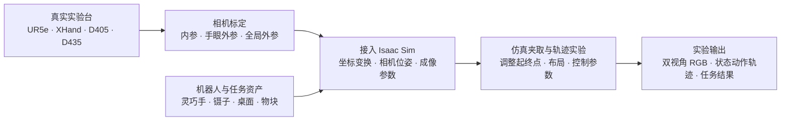
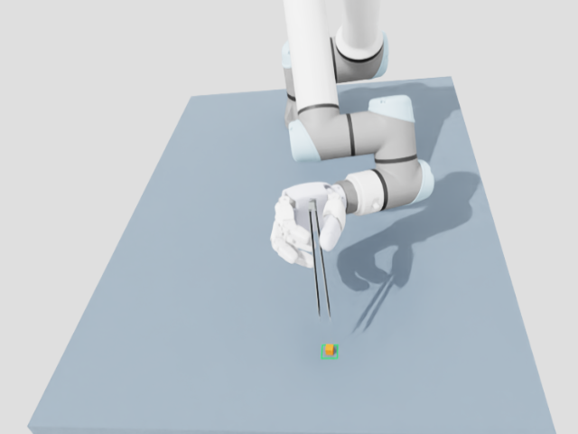

# 灵巧手镊子夹取物块：从真实相机标定到仿真轨迹实验

本项目面向 **UR5e + XHand 使用镊子夹取、搬运和放置物块**，提供一条从真实实验台到仿真轨迹实验的工作流程：先在真机上标定腕部与全局相机，再将相机参数和机器人坐标关系接入 Isaac Sim，搭建包含机械臂、灵巧手、镊子、桌面及物块的场景，最后在仿真中生成操作轨迹并同步记录双视角图像。

仓库将真机相机标定工具与仿真夹取任务放在一起，方便在同一套配置和代码中维护相机、场景及实验结果。当前采用可调整的近似场景建模方式，重点是建立真实相机与仿真相机之间的几何对应，并支持后续轨迹生成和视觉数据采集实验。



## 项目平台与当前状态

| 组成 | 当前配置 |
|---|---|
| 机械臂与灵巧手 | Universal Robots UR5e + XHand |
| 腕部相机 | Intel RealSense D405，随末端运动 |
| 全局相机 | Intel RealSense D435，相对机器人基座固定 |
| 真机标定主机 | Ubuntu 22.04.5 LTS |
| 仿真平台 | Isaac Sim 5.0.0 + Isaac Lab 2.2.1 |
| 当前任务控制 | 几何阶段控制器 + 已训练残差 PPO；评估使用确定性输出 |

截至 **2026-10-23**，已完成两路真机相机标定、仿真接入与投影检查，并跑通调整桌面布局后的指定抓放案例。该案例成功 **1/1**，最终 XY 误差约 **0.434 mm**；双视角各录制 712 帧，已逐帧解码验证。详细证据见 [验证摘要](docs/VALIDATION.md)，实际进度见 [PROJECT_PROGRESS.md](PROJECT_PROGRESS.md)。

任务从灵巧手已经持住镊子的状态开始。目前完成的是单案例仿真与记录能力；随机场景批量评估、正式数据集、VLA / WAM 训练及真机自主抓放尚未完成。当前桌面与物块布局为近似搭建，接触物理参数尚不能视为已经通过真机系统辨识。

## 阶段一：在真实实验台标定相机

使用 ChArUco 标定板采集图像，求解两路相机内参、腕部相机手眼外参及全局相机相对机器人基座的外参。标定后的结果用于确定仿真中相机的成像参数和安装位姿。

在连接 D405、D435 和 UR5e 的 Ubuntu 电脑上，从合并仓库根目录创建 Python 3.10–3.12 环境：

```bash
python3 -m venv .venv-calibration
source .venv-calibration/bin/activate
unset PIP_CONSTRAINT
python -m pip install --upgrade pip
python -m pip install -e './calibration[hardware]'

bash scripts/calibrate.sh --help
bash scripts/calibrate.sh devices
```

如果只做离线求解，安装 `python -m pip install -e ./calibration` 即可。硬件 SDK 仅在设备采集命令中导入。已有独立环境可设置 `CALIBRATION_PYTHON=/path/to/python`。

`scripts/calibrate.sh` 自动进入 calibration/，所以相对参数路径都以该目录为基准：

```bash
bash scripts/calibrate.sh robot-state --config configs/local.json
bash scripts/calibrate.sh validate \
  --session data/validation_wrist \
  --intrinsics results/wrist_intrinsics_v3.json \
  --result results/handeye.json \
  --out results/validation_wrist_new.json
```

标定步骤包括设备识别、内参采集与求解、腕部手眼标定、全局外参标定、独立验证及参数导出；各步骤的详细命令见下方标定说明。采集只读取机器人状态，不发送运动命令。完整原始流程见 [calibration/README.md](calibration/README.md)；相机序列号、局域网 IP 等机器配置在 `calibration/configs/local.json`，本地已保留，Git 忽略。

## 阶段二：将标定结果接入仿真并搭建场景

场景包含 UR5e、XHand、预持镊子、桌面、待夹物块与目标区域。机器人使用仓库内的 URDF / USD / 网格资产；桌面、物块起终点和工具初始状态通过配置调整。

相机使用真机标定得到的内参和外参：全局相机相对机器人基座固定，腕部相机跟随 `wrist_3_link`，结合已确认的 link → TCP 关系计算位姿。通过 `world_base_isaac.json` 将机器人基座坐标映射到仿真世界。相机适配器输出与目标内参对应的 rectified RGB，应通过 `rig.rgb()` 取图。

| 配置 / 资产 | 在场景中的作用 |
|---|---|
| [camera_rig_isaac.json](calibration/results/camera_rig_isaac.json) | 两路相机的分辨率、内参、安装变换和参考坐标系 |
| [world_base_isaac.json](calibration/results/world_base_isaac.json) | 机器人基座到仿真世界的变换 |
| [link_to_tcp.confirmed.json](calibration/configs/link_to_tcp.confirmed.json) | 已确认的腕部 link 与真实 TCP 关系 |
| [ur5e_xhand_right/](assets/ur5e_xhand_right/) | UR5e + XHand 机器人资产 |
| [calibrated_demo_y_table.json](simulation/configs/calibrated_demo_y_table.json) | 桌面尺寸、位置、HOME 及工具初始朝向 |
| [calibrated_demo_y_case.json](simulation/configs/calibrated_demo_y_case.json) | 物块初始 XY 和目标 XY |
| [xhand_local.json](simulation/configs/xhand_local.json) | 机器人资产路径与手部抓握配置 |

当前桌面 X×Y 为 `0.80×1.10 m`，长边沿 Y，中心 XY `(0,0.35)`、高度 `0.72 m`。物块初始 XY `(0.22,0.48)`、目标 XY `(-0.08,0.76)`，HOME XY `(0,0.48)`，工具初始偏航旋转 90°。可修改：

- [桌面与 HOME 配置](simulation/configs/calibrated_demo_y_table.json)
- [初始与目标点](simulation/configs/calibrated_demo_y_case.json)
- [仿真机器人配置](simulation/configs/xhand_local.json)

相机标定矩阵沿用真机结果；改变桌面或任务布局时，不会自动重新定向相机。若调整机器人基座或真实相机安装，应同步核对坐标变换和标定配置。

## 阶段三：运行夹取与轨迹生成实验

在已安装仿真依赖的机器上，从仓库根目录运行。当前服务器的路径如下；其他机器改为自己的克隆目录。

合并后已用下述统一入口重跑完整回合：指定案例成功 1/1，最终 XY 误差约 0.434 mm；两路视频各 712 帧，逐帧解码通过。16 项标定测试和两路真实验证数据复算通过，详细记录见 [docs/VALIDATION.md](docs/VALIDATION.md)。

```bash
cd /mnt/workspace/tweezers-sim2real
bash scripts/run_demo.sh
```

统一脚本自动加载 `env/setup_sim.sh`。指定结果目录或追加参数：

```bash
bash scripts/run_demo.sh runs/my_demo --seed 0
# 仅检查启动与录像，不作为完整任务验收：
bash scripts/run_demo.sh runs/my_smoke --episode-seconds 0.5
```

相对输出路径以 `simulation/` 为基准；目录必须不存在。默认录制 `wrist.mp4`、`global.mp4`，并保存 `trajectory.npz`、`camera_frames.jsonl`、相机/布局配置及成功判定。两路图像为 rectified、640×480、30 FPS、H.264/yuv420p。

冻结策略为 `models/policies/xhand_pick_place_ppo.pt`，稳定快照为 `models/snapshots/xhand_stable_grasp.json`，不依赖历史 runs/ 中的副本。相机位姿沿用真机标定结果，不随桌面布局重新定向。

可以在现有场景中调整物块起点、目标点、控制速度和场景布局，观察抓放路径、接触与释放行为，以及两路相机中的视觉变化。示例：

```bash
# 为速度变化实验生成一条新轨迹，保留当前相机和布局。
bash scripts/run_demo.sh runs/speed_004 --speed 0.04

# 从默认案例复制一份配置，再编辑其中的 start / goal XY 坐标。
cp simulation/configs/calibrated_demo_y_case.json \
  simulation/configs/my_pick_place_case.json
# 编辑 simulation/configs/my_pick_place_case.json 后运行：
bash scripts/run_demo.sh runs/custom_case \
  --cases configs/my_pick_place_case.json
```

`--cases` 的相对路径以 `simulation/` 为基准。当前双相机入口使用单环境，案例文件各提供一组 start / goal XY；坐标使用世界坐标系、单位为米，位置应在桌面和机器人可达区域内。修改配置后需要重新检查任务结果，默认案例的成功不代表新配置一定成功。

轨迹由几何阶段控制器和冻结残差 PPO 在线生成，包含接近、下降、夹紧、抬升、搬运、释放和撤离阶段。它可以作为仿真轨迹实验和视觉数据采集的起点。输出内容包括：

| 输出 | 用途 |
|---|---|
| `trajectory.npz` | 控制步上的关节、工具、物块状态、动作、任务阶段和成功标志；当前控制记录为 60 Hz |
| `wrist.mp4`、`global.mp4` | 腕部与全局视角 RGB，30 FPS |
| `camera_frames.jsonl` | 每帧仿真时间、相机位姿及机器人状态；配合轨迹中的 `render_control_steps` 对齐控制步与视频 |
| `evaluation.json` | 核对本次任务成功判定和位置误差 |
| `launch.json`、`source/` | 运行参数与源码/输入快照，便于比较实验 |

当前已验证单回合记录。正式批量数据集、数据格式转换及训练输入验收仍需后续完成。

## 可下载的演示结果

GitHub 版本包含 [demos/calibrated_pick_place/](demos/calibrated_pick_place/README.md)：已验证的腕部/全局视频、首尾截图、轨迹、帧位姿、判定结果与当次源码快照。下载源码后即可查看这一演示；重新仿真仍需安装外部运行环境。



历史 `simulation/runs/` 继续忽略；仅将这个指定案例整理为演示样例。公开内容范围和上传命令见 [docs/GITHUB_UPLOAD.md](docs/GITHUB_UPLOAD.md)。

## 目录与入口

```text
tweezers-sim2real/
├── calibration/           真机标定 Python 包、相机适配器、配置
│   ├── src/xhand_calib/   图像采集、内参、手眼、全局外参、验证、导出
│   ├── examples/          已验证 Isaac 相机适配器与 lens schema bootstrap
│   ├── results/           最终参数及历史求解结果；顶层 JSON 加入 Git
│   └── data/              已复制原始采集数据；本地保留，Git 忽略
├── simulation/            Isaac Sim 场景、任务、PPO、配置、历史工具
│   └── runs/              已复制历史运行以及新输出；Git 忽略
├── assets/                UR5e + XHand 的完整 URDF/USD/网格
├── demos/                 已验证双相机 Demo：视频、轨迹、结果与源码快照
├── models/                冻结 PPO checkpoint 与稳定预持镊快照
├── scripts/               统一运行、标定、输入检查、离线复验入口
├── env/                   仿真终端配置与机器本地配置模板
├── docs/                  坐标说明、迁移说明、参考照片
├── archives/              原确认包、交接 ZIP、校验材料；Git 忽略
├── verification/          合并后检查及验证结果；Git 忽略
├── PROJECT_PROGRESS.md    当前实际项目进度
└── MERGE_PROVENANCE.json  合并来源、版本和关键输入哈希
```

## 最终标定与检查

当前 Demo 使用的参数全部位于本仓库：

- `calibration/results/wrist_intrinsics_v3.json`、`global_intrinsics_v3.json`：最终内参。
- `calibration/results/handeye.json`、`global_extrinsics.json`：真机手眼与全局外参。
- `calibration/configs/link_to_tcp.confirmed.json`：已确认 wrist_3_link → TCP。
- `calibration/results/camera_rig_isaac.json`、`world_base_isaac.json`：仿真正式入口。
- `calibration/examples/isaac_camera_rig.py`：已验证 rectified 相机适配器，使用 `rig.rgb()` 取图。

坐标为米、列向量；真实 TCP 偏置为零，`T_link_tcp=I`；当前 env_0 的 `T_world_base` 为 Rz(pi) 加 `[0,0,0.72]` 平移。原确认包保持原样存档在 `archives/calibration_confirmed_20261023/`；报告内绝对路径与哈希是当时的溯源信息。

静态输入/模型/归档检查仅使用 Python 标准库：

```bash
python3 scripts/check_repo.py
```

在独立标定环境中，重算已复制的真实验证数据：

```bash
.venv-calibration/bin/python scripts/verify_calibration.py \
  --out "verification/real_validation_$(date -u +%Y%m%dT%H%M%S)"
```

现有标定测试：

```bash
PYTHONPATH=calibration/src .venv-calibration/bin/python \
  -m unittest discover -s calibration/tests -v
```

双相机联合交叉验证现阶段暂缓，不作为继续仿真视觉采集的前置条件。已完成的是各路固定板独立验证、真实/仿真 TCP 对比以及仿真投影检查。

## 新终端、迁移和备份

当前机器的合并仓库在 `/mnt/workspace/tweezers-sim2real`。创建时 CPFS 返回 `Disk quota exceeded`，所以先在这里完成。**此路径属于当前实例系统盘，停止/更换实例前，应把整个目录或完整压缩包保存到配额足够的持久存储。** 原两项目未删除，仿真软件安装与 Python 环境继续使用当前机器已有安装。

只配置仿真终端时使用 `source env/setup_sim.sh`；该命令会进入 simulation/。新机器可先复制 `env/local.env.example` 为 `env/local.env`，配置本机 Python 和可选 NVIDIA 用户态库路径。脚本选择已存在的环境/库，不安装或更换服务器内核驱动。

项目源码、资产和模型使用相对位置，可整体移动。Isaac Sim 5.0.0 / Isaac Lab 2.2.1 / Python 3.11 / PyTorch 2.7.0+cu128、系统图形库与匹配的 NVIDIA 驱动需在目标机器另行配置。

当前服务器的 Isaac Lab 是从原 `tweezers_xhand_w01/software/IsaacLab-2.2.1` 编辑安装到外部仿真环境的，原软件目录继续作为 SDK 依赖使用。若后续清理原目录，应先迁移或重新安装这个外部 SDK；合并没有修改已运行成功的 Python 安装环境。

Git 默认保存代码、资产、冻结模型及标定 JSON；**Git 克隆不会包含已忽略的原始采集数据、历史视频和验证归档**。完整备份在仓库外执行：

```bash
tar -C /mnt/workspace -czf /mnt/workspace/tweezers-sim2real-full.tar.gz tweezers-sim2real
```

CPFS 配额恢复后，可整体复制回挂载存储：

```bash
cp -a /mnt/workspace/tweezers-sim2real /cpfs/user/xiaoqihuang/
cd /cpfs/user/xiaoqihuang/tweezers-sim2real
python3 scripts/check_repo.py
bash scripts/run_demo.sh
```

历史 simulation/README.md 及其他技术报告保留原阶段内容，部分引用原作者机器路径或不随包提供的旧实验。本 README 与统一 scripts/ 是合并后的当前入口。来源与许可见 [THIRD_PARTY_NOTICES.md](THIRD_PARTY_NOTICES.md)，进度见 [PROJECT_PROGRESS.md](PROJECT_PROGRESS.md)，整理范围见 [docs/MERGE.md](docs/MERGE.md)。
