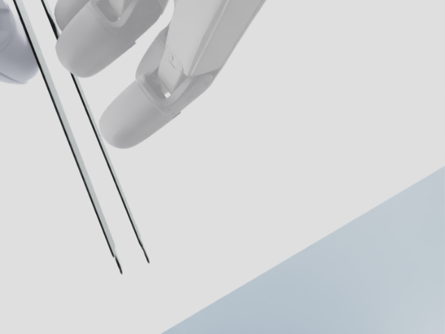

# 已标定双相机夹取演示

来自 2026-10-23 合并仓库的完整指定案例回归运行，seed=0。仿真成功 1/1，最终 XY 误差约 0.434 mm，时长约 23.70 s。这一结果不代表随机场景总体成功率，也不是真机自主抓取结果。

- [全局相机视频](global.mp4) / [腕部相机视频](wrist.mp4)：640×480，30 FPS，H.264/yuv420p，各 712 帧。GitHub 可下载观看；README 链接不保证直接内嵌播放。
- `global_first.png`、`global_last.png`、`wrist_first.png`、`wrist_last.png`：首尾画面。
- `trajectory.npz`：记录的轨迹；`camera_frames.jsonl`：帧时间与相机位姿。
- `evaluation.json`、`demo_verification.json`：成功判定与视频检查。
- 其余 JSON 与 `source/`：当次输入、源码快照和来源记录。JSON 内绝对路径保留运行时原始值；这些是历史记录，重新运行请使用根目录 `scripts/run_demo.sh`。
- `MANIFEST.sha256.json`：从原运行目录复制的文件 SHA-256，供核对。

省略约 90.7 MiB 的 `final_scene.usda`，它是仿真展开输出；运行使用仓库的资产和配置。原始完整结果继续保存在本地 `simulation/runs/merged_repo_demo_20261023/`。




重新运行（已安装仿真环境）：

```bash
bash scripts/run_demo.sh runs/my_demo
```
